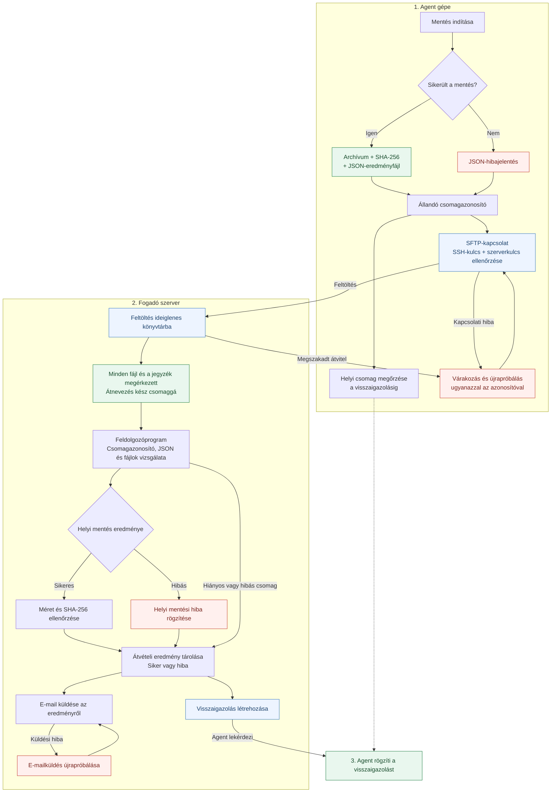

# Tervezett SFTP-kommunikáció

A JSON-hibajelentés ugyanazon az átadási útvonalon halad, mint a sikeres mentés csomagja. A szerver a teljesen feltöltött csomagot dolgozza fel, és a saját ellenőrzésének eredménye alapján küld értesítést.

Az ábra a tervezett működést mutatja. A helyi csomagok későbbi törlésének feltételeit külön határozzuk meg.
